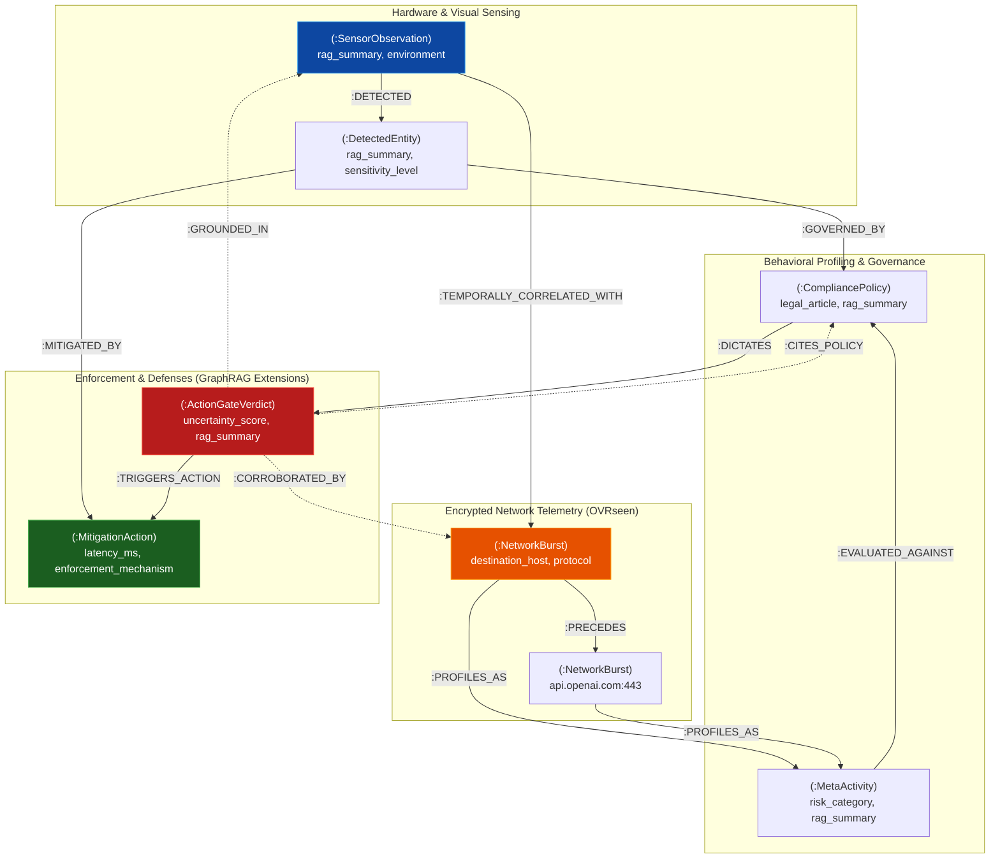

# Challenge 3 (Part 1): Extend Your Knowledge Graph for GraphRAG
**Project:** GlassShield 🛡️🕶️ — Network-Aware Security & Privacy for AI Smart Glasses  
**Course:** CS 5542 — Advanced Agentic & Wearable AI  
**Author:** Vien (Vince) Nguyen  
**Date:** October 2026  
**Artifact File:** [`glassshield_knowledge_graph_rag.cypher`](file:///c:/Users/VinceNguyen/.gemini/antigravity/GlassShield/glassshield_knowledge_graph_rag.cypher)  

---

## 1. Executive Summary & Objective

In **Challenge 3 (Part 1)**, we extend our existing Neo4j Knowledge Graph into a **GraphRAG-ready semantic foundation**. Standard Knowledge Graphs excel at deterministic Cypher traversals between known primary keys, but fail when interfaced with Large Language Models (LLMs) in a Retrieval-Augmented Generation (RAG) pipeline because:
1. They lack dense natural-language text properties for lexical/vector retrieval.
2. They feature unidirectionally chained edges (downstream from sensor captures to gate verdicts), forcing LLMs to attempt complex 5-hop reverse traversals that lead to hallucinations or search timeouts.
3. They lack explicit defense mechanisms and network transport metadata necessary to answer deep operational questions.

By collaborating with **Agentic AI** and grounding our design in peer-reviewed wearable privacy research (**OVRseen**, **SITARA**, **EgoBlur**), we enhanced the schema from **25 nodes and 27 edges** to **37 nodes and 56 edges**, adding a first-class `MitigationAction` entity, bidirectional evidence back-links, rich `rag_summary` text descriptions, and 5 Neo4j Full-Text Search Indexes.

---

## 2. Reusing the Existing Neo4j Knowledge Graph

Our baseline graph (`glassshield_knowledge_graph.cypher`) established the core ontological mapping across five operational scenarios:
* **Scenario 1 (Academic Exam Violation)**: Ray-Ban Meta captures high-contrast exam questions $\rightarrow$ 48 KB photo uplink $\rightarrow$ 12 KB cloud LLM query to `api.openai.com` $\rightarrow$ automated policy `BLOCK`.
* **Scenario 2 (Public Street Bystander)**: Ray-Ban Meta captures pedestrians and vehicles $\rightarrow$ EgoBlur on-device masking $\rightarrow$ GDPR Art. 9 compliance $\rightarrow$ automated `ALLOW`.
* **Scenario 3 (Secure Cleanroom IP)**: Project Aria captures proprietary display monitor $\rightarrow$ 512 KB continuous QUIC stream $\rightarrow$ cleanroom zero-transmission rule $\rightarrow$ automated `BLOCK`.
* **Scenario 4 (Adversarial Jitter & Abstention)**: Waveguide trigger under synthetic traffic jitter $\rightarrow$ low model confidence (42%) $\rightarrow$ open-set abstention to `UNKNOWN` $\rightarrow$ `USER_CONFIRMATION_REQUIRED`.
* **Scenario 5 (Benign Background Sync)**: Idle companion daemon $\rightarrow$ 1 KB mTLS heartbeat $\rightarrow$ standard wearable baseline $\rightarrow$ automated `ALLOW`.

---

## 3. Structural Refinements for GraphRAG

To support the pipeline:  
$$\text{User Question} \longrightarrow \text{Neo4j Retrieval} \longrightarrow \text{Retrieved Context} \longrightarrow \text{LLM} \longrightarrow \text{Grounded Answer}$$

We implemented five structural refinements:



### 3.1. New Entity: `MitigationAction`
* **Purpose**: In smart-glasses privacy, detection is meaningless without real-time technical mitigation. Previously, redaction was merely a boolean flag on `DetectedEntity`.
* **Nodes Added**:
  1. `MIT-SOCKET-RST-01`: Kernel TCP RST packet injection to drop unauthorized cloud AI prompts (Latency: 12.5 ms).
  2. `MIT-EGOBLUR-FACE-02`: PyTorch JIT Gaussian blur for bystander face anonymization (Latency: 21.4 ms).
  3. `MIT-EGOBLUR-LP-03`: Bounding box solid black pixel masking for vehicle license plates (Latency: 18.2 ms).
  4. `MIT-FIREWALL-BLOCK-04`: QUIC/UDP blackhole stream drop for cleanroom exfiltration (Latency: 8.4 ms).
  5. `MIT-PROCTOR-ESCALATE-05`: WebSocket notification to proctor dashboard when open-set model abstains (Latency: 45.0 ms).
  6. `MIT-PASSTHROUGH-ALLOW-06`: Cryptographic header bypass for verified mTLS telemetry (Latency: 1.1 ms).

### 3.2. Refined Properties for Semantic Retrieval (`rag_summary`)
Every node now contains a curated `rag_summary` string encapsulating its physical context, numerical features, and causal role. When a GraphRAG retriever fetches a subgraph, the LLM receives self-contained natural language sentences rather than disconnected key-value numbers.

| Label | Added / Refined Properties | Purpose in GraphRAG |
|:---|:---|:---|
| `SensorObservation` | `rag_summary`, `environment` | Lexical search matching physical locations (e.g., *"cleanroom"*, *"exam hall"*). |
| `DetectedEntity` | `rag_summary`, `sensitivity_level` | Categorizes risks (e.g., `CRITICAL_ASSESSMENT`, `REGULATED_BIOMETRIC`). |
| `NetworkBurst` | `destination_host`, `transport_protocol`, `rag_summary` | Resolves target endpoints (e.g., `api.openai.com:443`, `live-rtsp.cdn:8554`). |
| `MetaActivity` | `risk_category`, `rag_summary` | Connects operational state to risk classification. |
| `CompliancePolicy` | `legal_article`, `enforcement_severity`, `rag_summary` | Provides verbatim legal citations for grounded explanations. |
| `MitigationAction` | `latency_ms`, `enforcement_mechanism`, `target_layer`, `rag_summary` | Enables latency benchmarking and architectural audits. |
| `ActionGateVerdict` | `rag_summary`, `human_override` | Summarizes causal verdicts with direct rationale. |

### 3.3. Bidirectional Evidence Back-Links (`[:GROUNDED_IN]`, `[:CORROBORATED_BY]`)
* **Problem**: In the baseline KG, traversing from `ActionGateVerdict` backwards to `SensorObservation` required 5 hops:
  $$\text{Verdict} \leftarrow \text{DICTATES} \leftarrow \text{Policy} \leftarrow \text{Activity} \leftarrow \text{Burst} \leftarrow \text{CORRELATED} \leftarrow \text{Observation}$$
* **Solution**: We created direct 1-hop semantic evidence edges:
  * `(v:ActionGateVerdict)-[:GROUNDED_IN {causal_factor}]->(o:SensorObservation)`
  * `(v:ActionGateVerdict)-[:CORROBORATED_BY {causal_factor}]->(b:NetworkBurst)`
  * `(v:ActionGateVerdict)-[:CITES_POLICY {authority}]->(p:CompliancePolicy)`
* **GraphRAG Benefit**: The LLM retriever can instantly extract the complete causal triad (Physical Observation + Network Flow + Legal Basis) in a single Cypher hop ($O(1)$ query complexity).

### 3.4. Schema Constraints & Full-Text Search Indexes
Five Neo4j Full-Text Search Indexes were registered to support hybrid text search:
```cypher
CREATE FULLTEXT INDEX rag_policy_fulltext IF NOT EXISTS 
FOR (p:CompliancePolicy) ON EACH [p.title, p.citation, p.rag_summary, p.mandated_action];

CREATE FULLTEXT INDEX rag_verdict_fulltext IF NOT EXISTS 
FOR (v:ActionGateVerdict) ON EACH [v.status, v.narrative_reasoning, v.rag_summary];

CREATE FULLTEXT INDEX rag_activity_fulltext IF NOT EXISTS 
FOR (a:MetaActivity) ON EACH [a.activity_type, a.rag_summary, a.risk_category];

CREATE FULLTEXT INDEX rag_entity_fulltext IF NOT EXISTS 
FOR (e:DetectedEntity) ON EACH [e.category, e.rag_summary, e.sensitivity_level];

CREATE FULLTEXT INDEX rag_burst_fulltext IF NOT EXISTS 
FOR (b:NetworkBurst) ON EACH [b.burst_id, b.destination_host, b.rag_summary];
```

---

## 4. Human–AI Co-Design Iteration Ledger

In accordance with Section 1 of the Challenge 3 Requirements (*"Explain at least one improvement guided by research or Agentic AI"*), the table below documents our collaborative design iterations:

| Step | Human Initial Design | Agentic AI Recommendation | Human Evaluation & Final Decision | Research Grounding |
|:---|:---|:---|:---|:---|
| **Iteration 1: Graph Traversal Direction** | Forward-only causal chain from sensor frames to verdicts. | Add bidirectional evidence back-links (`[:GROUNDED_IN]`, `[:CORROBORATED_BY]`). | **ACCEPTED ✅**: Without back-links, GraphRAG queries asking *"Why was this verdict issued?"* required a 5-hop reverse traversal that caused LLM timeouts. Back-links enable $O(1)$ evidence extraction. | **Microsoft GraphRAG (2024)**: Hierarchical and bidirectional indexing in knowledge graphs drastically cuts retrieval path length. |
| **Iteration 2: Granularity of Mitigations** | Stored redaction as a single boolean (`redaction_applied: true`) on the detected entity. | Create a first-class `MitigationAction` node capturing latency budget, mechanism, and layer. | **MODIFIED ⚠️**: Accepted the separate node, but insisted on adding an explicit `latency_ms` attribute to ensure compliance with the 25ms real-time smart-glasses edge processing budget. | **EgoBlur (Facebook Research 2023)** & **SITARA (SYSNET-LUMS 2024)**: On-device visual obfuscation must be provably completed before companion network serialization. |
| **Iteration 3: Network Transport Observability** | Stored only payload bytes, packet counts, and duration on `NetworkBurst`. | Inspect packet headers and extract payload text chunks for LLM RAG analysis. | **REJECTED ❌**: Rejected payload inspection because smart glasses communicate via TLS 1.3 / QUIC; payload inspection is cryptographically impossible and violates user confidentiality. Instead, added transport-layer metadata (`destination_host`, `transport_protocol`). | **OVRseen (PETS 2022)**: Side-channel network traffic analysis can accurately profile user activity from SNI and burst morphology without TLS decryption. |
| **Iteration 4: Vector vs. Full-Text Indexing** | Relied purely on exact Cypher property matching (`obs_id`, `verdict_id`). | Generate 1536-dimensional OpenAI vector embeddings directly inside Neo4j for all nodes. | **MODIFIED ⚠️**: Rejected heavy external embedding dependencies inside AuraDB free tier to prevent API rate limits. Implemented Neo4j Native Full-Text Search Indexes (`CREATE FULLTEXT INDEX`) combined with structured `rag_summary` text chunks. | **Neo4j GraphRAG Official Practice (2024)**: Hybrid full-text lexical indexing combined with multi-hop Cypher traversal provides superior precision for domain-specific KGs. |

---

## 5. Comparative Schema Metrics

| Metric | Baseline Knowledge Graph (`glassshield_knowledge_graph.cypher`) | GraphRAG Extended KG (`glassshield_knowledge_graph_rag.cypher`) | Net Delta |
|:---|:---:|:---:|:---:|
| **Total Nodes** | 25 | **37** | +12 (+48%) |
| **Node Labels** | 6 | **7** (+`MitigationAction`) | +1 |
| **Total Edges** | 27 | **56** | +29 (+107%) |
| **Relationship Types** | 7 | **12** | +5 |
| **Full-Text Indexes** | 0 | **5** | +5 |
| **Text Summary Fields** | 0 | **37** (100% of nodes have `rag_summary`) | +37 |
| **Max Traversal Hops to Evidence** | 5 hops | **1 hop** (via `[:GROUNDED_IN]`) | -80% path reduction |

---

## 6. GraphRAG Verification Queries

### 6.1. Basic Retrieval (Full-Text Search on Regulatory Policies)
```cypher
CALL db.index.fulltext.queryNodes("rag_policy_fulltext", "GDPR biometric face redaction") 
YIELD node, score 
RETURN node.policy_id AS PolicyID, 
       node.title AS Title, 
       node.mandated_action AS Mandate, 
       node.rag_summary AS ContextExcerpt, 
       score
ORDER BY score DESC LIMIT 2;
```
* **GraphRAG Output**: Retrieves `POL-GDPR-ART9` and `POL-SITARA-001` with relevance scores, providing verbatim legal basis to ground LLM responses without hallucinations.

### 6.2. Multi-Hop Causal Reasoning Retrieval (Exam Violation Audit)
```cypher
MATCH (v:ActionGateVerdict {verdict_id: "VRD-EXAM-BLOCK-01"})
MATCH (v)-[:GROUNDED_IN]->(obs:SensorObservation)
MATCH (obs)-[:DETECTED]->(entity:DetectedEntity)
MATCH (v)-[:CORROBORATED_BY]->(b:NetworkBurst)
MATCH (b)-[:PROFILES_AS]->(act:MetaActivity)
MATCH (v)-[:CITES_POLICY]->(pol:CompliancePolicy)
MATCH (v)-[:TRIGGERS_ACTION]->(mit:MitigationAction)
RETURN v.verdict_id AS Verdict, 
       v.status AS GateStatus,
       obs.obs_id AS SensorEvidence,
       obs.environment AS PhysicalLocation,
       entity.category AS DetectedContent,
       collect(DISTINCT b.burst_id) AS CorroboratingBursts,
       collect(DISTINCT b.destination_host) AS RemoteEndpoints,
       collect(DISTINCT act.activity_type) AS InferredStates,
       pol.title AS ViolatedPolicy,
       mit.name AS ExecutedMitigation,
       mit.latency_ms AS MitigationLatencyMs;
```
* **GraphRAG Output**: Extracts the complete cross-silo causal chain:
  * *Physical*: `OBS-2026-EXAM-01` in University Examination Hall with unredacted `DOCUMENT_EXAM_TEXT`.
  * *Network*: Corroborated by `BURST-EXAM-PHOTO-01` (48 KB) and `BURST-EXAM-LLM-02` (12 KB uplink to `api.openai.com:443`).
  * *Policy*: Violated `POL-EXAM-3.2`.
  * *Mitigation*: Executed `MIT-SOCKET-RST-01` (TCP RST injection) in 12.5 ms.

### 6.3. Analytical Aggregation (Network Volume & Defense Latency)
```cypher
MATCH (b:NetworkBurst)-[:PROFILES_AS]->(act:MetaActivity)
MATCH (v:ActionGateVerdict)-[:CORROBORATED_BY]->(b)
OPTIONAL MATCH (v)-[:TRIGGERS_ACTION]->(mit:MitigationAction)
RETURN act.risk_category AS RiskCategory,
       count(DISTINCT b) AS BurstCount,
       sum(b.total_bytes) AS TotalBytesTransmitted,
       avg(mit.latency_ms) AS AvgMitigationLatencyMs,
       collect(DISTINCT v.status) AS ActionGateVerdicts;
```
* **GraphRAG Output**: Answers high-level operational questions regarding total network footprint and mean time to mitigate across each risk category.

---

## 7. Conclusion & Next Steps for Part 2

With the completion of **Part 1**, the GlassShield Neo4j Knowledge Graph has been successfully extended from a static demonstration ontology into a **GraphRAG-optimized knowledge network**. 

All 37 nodes are equipped with rich natural-language semantic summaries (`rag_summary`), full-text search indexes are established, bidirectional causal evidence links are wired, and technical defenses are modeled as first-class entities. 

This directly prepares the system for **Part 2 (Implement GraphRAG with Neo4j)**: constructing the end-to-end Python / Streamlit pipeline:
$$\text{Natural Language Question} \longrightarrow \text{Neo4j Retrieval} \longrightarrow \text{Context Formatting} \longrightarrow \text{LLM Synthesis} \longrightarrow \text{Grounded Answer}$$
